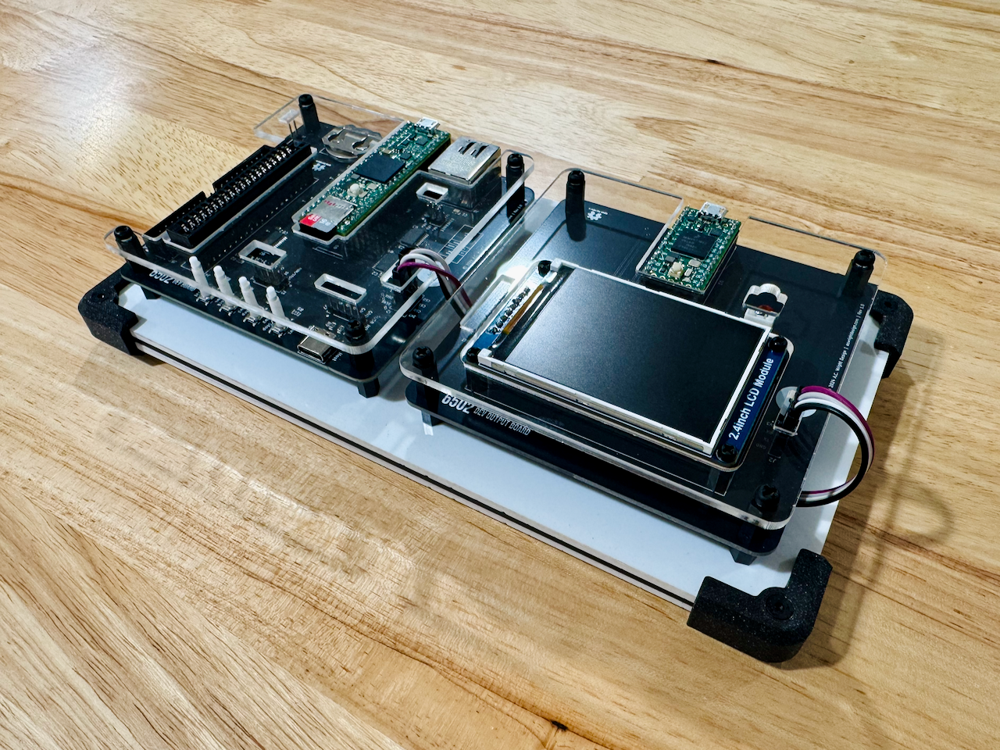

6502-DEV
========

An **AC6502** retro-style 8-bit computer based on the **65C02** microprocessor.

> 📖 **Guide:** [AC6502 Documentation](https://acwright.github.io/6502-DOCS/) — the user's and programmer's guide for the whole family.
> See [DEV's page in the family appendix](https://acwright.github.io/6502-DOCS/family/dev).

---

**Building one? Every part you need, with supplier numbers and known issues, is in [BOM.md](BOM.md).**

## Table of Contents

- [Overview](#overview)
- [Architecture](#architecture)
- [Systems](#systems)
- [Software](#software)
- [Hardware](#hardware)
  - [DEV Board](#dev-board)
  - [DEV Output Board](#dev-output-board)
- [Firmware](#firmware)
  - [DB Emulator](#db-emulator)
  - [DOB Display](#dob-display)
- [CAD](#cad)
- [Production](#production)
- [Schematics](#schematics)
- [Shared lines](#shared-lines)
- [Libraries](#libraries)
- [Bill of Materials](#bill-of-materials)
- [License](#license)

---

## Overview

The AC6502 ecosystem is a family of open-source, 65C02-based computers sharing a common architecture, memory map, and [BIOS](https://github.com/acwright/6502-BIOS). Each computer in the family is purpose-built for a different use case but runs the same software and firmware.

The **DEV** is an emulation-based development system. It replaces the physical 65C02 CPU with a [Teensy 4.1](https://www.pjrc.com/store/teensy41.html) running cycle-accurate 65C02 emulation via [vrEmu6502](https://github.com/visrealm/vrEmu6502).
## Architecture

All AC6502 computers share:

- **CPU**: 65C02 (or accurate emulation)
- **Memory**: 32KB RAM + 32KB ROM, with optional banked RAM expansion
- **Memory Map**: Standardized across the ecosystem — zero page, stack, I/O space ($8000–$9FFF), system ROM, and interrupt vectors at $FFFA–$FFFF
- **Bus**: 16-bit address bus, 8-bit bidirectional data bus, standard 65C02 control signals (RW, PHI2, RESET, IRQ, NMI, RDY, SYNC)
- **BIOS**: A common [BIOS](https://github.com/acwright/6502-BIOS) provides the kernel, monitor, and BASIC interpreter across all systems

## Systems

| Project | Description |
|---------|-------------|
| [6502-ACE](https://github.com/acwright/6502-ACE) | All-in-one Computer Experience — A single board computer |
| [6502-COB](https://github.com/acwright/6502-COB) | Computer On a Backplane — Modular desktop computer with expandable card slots |
| [6502-DEV](https://github.com/acwright/6502-DEV) | Development Environment Vehicle — Emulation-based dev system (YOU ARE HERE) |
| [6502-KIM](https://github.com/acwright/6502-KIM) | Keypad Input Monitor - KIM-1 inspired minimal computer |
| [6502-VCS](https://github.com/acwright/6502-VCS) | Video Computer System — Cartridge-based retro gaming console |

## Software

| Project | Description |
|---------|-------------|
| [6502-BIOS](https://github.com/acwright/6502-BIOS) | The shared BIOS (kernel, monitor, BASIC) for all AC6502 computers |
| [6502-EMULATOR](https://github.com/acwright/6502-EMULATOR) | Emulator for the whole family — desktop app, browser build, and a command line for scripted runs |
| [6502-PRG](https://github.com/acwright/6502-PRG) | Template project for writing assembly language programs |
| [6502-CRT](https://github.com/acwright/6502-CRT) | Template project for writing assembly language cartridges |
| [6502-ASM](https://github.com/acwright/6502-ASM) | Assembly language example programs and demos |
| [6502-BAS](https://github.com/acwright/6502-BAS) | BASIC program listings |
| [6502-WOZMON](https://github.com/acwright/6502-WOZMON) | Wozmon as a standalone ROM |
| [6502-NOP](https://github.com/acwright/6502-NOP) | An all-NOP ROM, for probing a board during bring-up |
| [6502-DOCS](https://github.com/acwright/6502-DOCS) | The documentation site — the guide, the printable reference cards, branding and label artwork |
| [cffs](https://github.com/acwright/cffs) | Builds CompactFlash disk images for the BIOS filesystem |
| [bastok](https://github.com/acwright/bastok) | Tokenizes BASIC listings into `.prg` images, and back |
| [bin2woz](https://github.com/acwright/bin2woz) | Converts a binary into a Wozmon serial upload |

## Hardware

This repository contains KiCad 7.0+ PCB designs for the two boards that make up the DEV system.

### DEV Board
`Hardware/DEV Board/`

The main board hosting the Teensy 4.1. Provides 65C02 bus emulation, SD card storage, Ethernet, USB keyboard/joystick input, and hardware control buttons (Run/Stop, Step, Reset, Frequency). Includes a bus connector and card slot with level shifters for optional real hardware expansion.

### DEV Output Board
`Hardware/DEV Output Board/`

The AV output board hosting a Teensy 4.0 and a 2.4" ILI9341 TFT LCD. Emulates a TMS9918A Video Display Processor and a MOS 6581 SID audio synthesizer, driven in real time via high-speed serial from the DEV Board. The DEV Board sends the same AV packets over USB at the same time, so a browser can render the output in parallel with this board — the two paths are simultaneous, not alternatives.

## Firmware

This repository contains [PlatformIO](https://platformio.org/)-based firmware for both boards.

### DB Emulator
`Firmware/DB Emulator/`

Firmware for the Teensy 4.1 on the DEV Board. Provides:

- Cycle-accurate 65C02 emulation
- SD card ROM/cartridge/program loading and memory snapshots
- Ethernet with mDNS (`6502.local`) and an embedded web control interface
- USB keyboard and joystick support (Xbox 360/One)
- AV packet output to both destinations at once — over USB to the browser (Web Serial API) and over hardware UART at 6 Mbps to the DOB Display
- Serial terminal interface (115200 baud)
- Hardware button control (Run/Stop, Step, Reset, Frequency)
- Variable CPU clock speed

See [Firmware/DB Emulator/README.md](./Firmware/DB%20Emulator/README.md) for setup and usage instructions.

### DOB Display
`Firmware/DOB Display/`

Firmware for the Teensy 4.0 on the DEV Output Board. Provides:

- TMS9918A VDP emulation (all four display modes, 256×192 active area)
- MOS 6581 SID audio emulation (3 voices, ADSR envelopes, PWM audio output)
- AV packet stream input at 6 Mbps over hardware UART from the DB Emulator (which also streams the same packets over USB to the browser)

See [Firmware/DOB Display/README.md](./Firmware/DOB%20Display/README.md) for setup and usage instructions.

## CAD
`CAD/`

3D-printable enclosure parts and laser-cut top panels for the DEV system.

**Board images** are in `CAD/Images/<Board>/Rev X/`: `Front.png` and `Back.png` on white, and `Front Transparent.png` and `Back Transparent.png` with no background. Every image is a 3D render at the same size, with the black solder mask and white silkscreen the boards are made with. Bare-board photos may differ, because the renders show parts fitted.

**Top panels are versioned by board revision**, like `Hardware/`: `CAD/Tops/<Board>/Rev X/`. Each revision has its own complete folder, even when two revisions share the same files. `Bases/` holds the parts for a whole computer, not for one board, so it isn't versioned.

The **[plate mounting drawing](CAD/Bases/Plate%20Mounting%20Drawing.png)** ([SVG](CAD/Bases/Plate%20Mounting%20Drawing.svg)) shows where the DEV Board and the DEV Output Board mount on the base plate, with every hole's position and the hardware the build needs. The plate is a stack of three 3 mm acrylic layers.

## Production
`Production/`

[REVISIONS.md](REVISIONS.md) lists every board revision: whether it was made, its JLCPCB order, the commit it was made from, and what fits it.

JLCPCB-ready Gerber files and BOM/CPL for PCB fabrication and assembly.

## Schematics
`Schematics/`

PDF schematics for each board.

## Shared lines

Five lines of the 6502 bus are shared by every board on it: `RESB`, `IRQB`, `NMIB`, `RDY` and `BE`. A board may pull one of these lines low, and nothing drives one high. Each line is held high by one 10kΩ pull-up resistor to VCC, on the board with the CPU: the ACE Board, the KIM Board, the VCS Main Board, the COB CPU Card or CPU Card Pro, or the DEV Board. No other board has one. Two pull-ups on the same line would sit in parallel and lower its resistance, so a card that adds its own pull-up changes the machine for every other board. The VIAs and PIAs in the BOMs, the W65C22N and W65C21N, have open-drain interrupt outputs for this reason. A W65C22S drives `IRQB` high as well as low, so it can't share the line without a diode.

The same holds where a board has its own reset circuit. A reset switch, its timer and the transistor that pulls `RESB` low can be on any board, such as the COB Backplane Pro or the Clock Card, but the `RESB` pull-up is only ever on the board with the CPU. Each of those boards draws its pull-ups together, in one group on its schematic.

`SOB` is a CPU pin that isn't on the bus. It is tied to VCC, directly or through a 10kΩ resistor.

A few chips have a pull-up of their own inside the chip, such as an ATmega's reset pin. Where such a pin is wired to `RESB`, its pull-up of 30–60kΩ sits in parallel with the 10kΩ one. That's harmless, because whatever pulls `RESB` low can sink the extra current many times over.

A revision that doesn't follow this yet says so in its known issues in [BOM.md](BOM.md), with what to fit or remove.

## Libraries
`Libraries/`

Shared KiCad symbol and footprint libraries used across all AC6502 hardware projects, with their 3D models in `Models/`. A part is named for what it is and its shape, such as `RJ45 Jack LED` or `CR2032 Holder`, never for a manufacturer's part number, so a replacement part with the same footprint fits without renaming anything. The part numbers to buy are in [BOM.md](BOM.md). Every AC6502 repository carries the same copy of each part.

## Bill of Materials

Every part for every board, by revision, is in **[BOM.md](BOM.md)**, with supplier numbers, known issues, build notes and files to upload to Digi-Key and Mouser. What changed in each revision, and what is known about each one, is in **[REVISIONS.md](REVISIONS.md)**.

## License

Hardware designs are released under the [CERN Open Hardware Licence Version 2 – Permissive](https://ohwr.org/cern_ohl_p_v2.txt).  
Firmware is released under the MIT License — [DB Emulator](./Firmware/DB%20Emulator/LICENSE), [DOB Display](./Firmware/DOB%20Display/LICENSE).
